# Rotom Spark — State-Centric Battle Engine Architecture

**Status:** Proposed target architecture / design reference  
**Scope:** Rotom Spark (deterministic Pokémon battle engine), with boundaries to Rotom Brawl and Rotom Brain  
**Audience:** Maintainers and coding agents  
**Note:** This is a proposed architecture, not a claim that every component is currently implemented.

## 1. Architecture goals

Rotom Spark is a **deterministic state-transition engine** for accurately resolving Pokémon battles. The authoritative **BattleState** is the central data model; everything else exists to inspect it, decide what should happen, and transform it into the next valid state.

1. **Readable state:** battle state is explicit, inspectable, serializable, and testable.
2. **Controlled mutation:** only the kernel writes authoritative state; the kernel enforces representation invariants, not the full Pokémon rulebook.
3. **Rules separated from storage:** mechanics owns *why, when, and under which conditions* a mutation may happen.
4. **Unified execution:** moves share a resolution pipeline; ordinary moves are data and exceptional moves use limited, typed hooks.
5. **Determinism:** identical initial state, legal decisions, content/rules version, and RNG seed/state produce identical results and event order.
6. **Battle fidelity:** correct ordering, targeting, Pokémon-specific effects, switching, fainting, items, abilities, and doubles mechanics take precedence over artificial simplification.
7. **Performance:** compact IDs, reusable definitions, batch-friendly state/observation exports, and profiling-driven optimization.

## 2. High-level system map

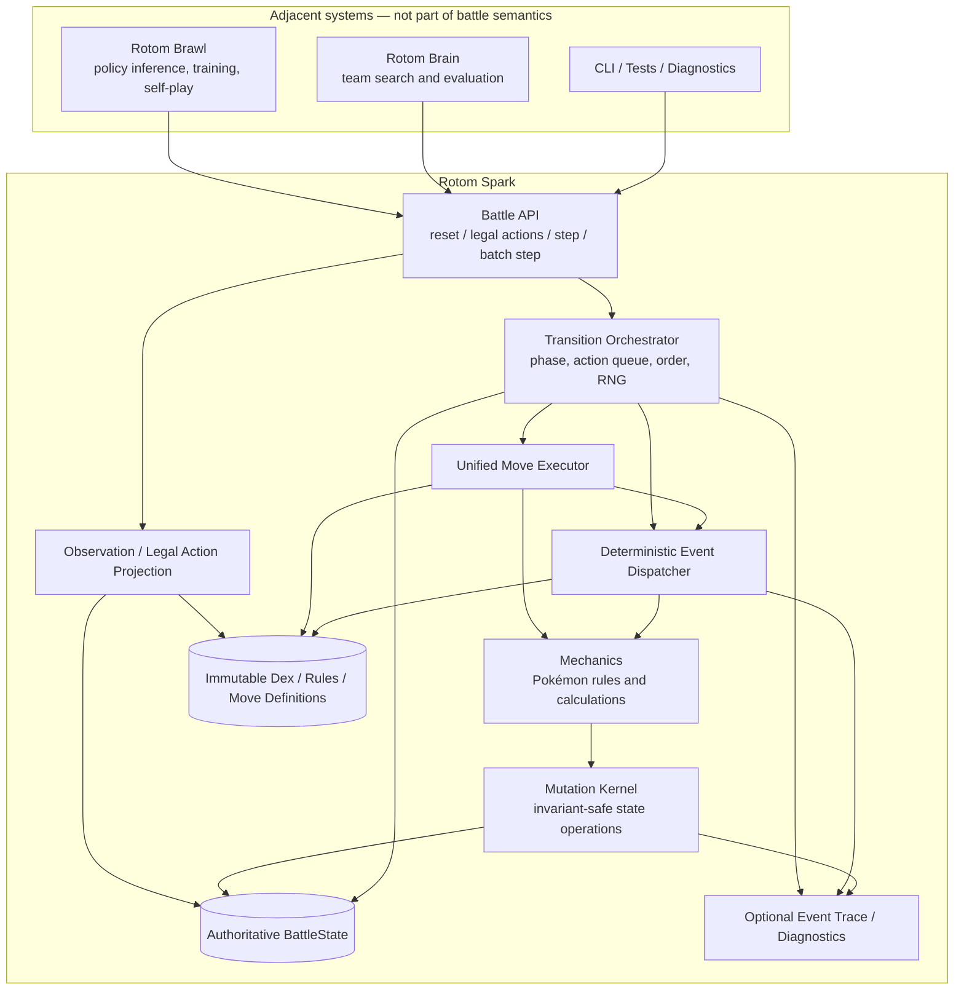

**Reading the arrows:** orchestrator and observers may *read* state; only the kernel may *write* it. Mechanics and handlers request mutations through the kernel. Traces are optional outputs, not an alternative source of truth.

## 3. Dependency and authority rules

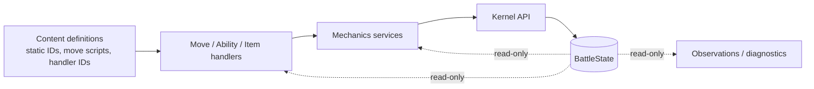

- **BattleState**: authoritative dynamic data, including teams, active slots, HP, PP, statuses, stat stages, item state, ability runtime state, side/field effects, turn phase, decision state, and RNG state/stream identity as appropriate.
- **Kernel**: semantic primitives, e.g. `set_hp`, `damage_hp`, `heal_hp`, `change_stage`, `set_status`, `consume_item`, `switch_active`, `set_field_effect`, `tick_duration`. Enforce valid indices, HP bounds, stage bounds, slot consistency, and representation invariants. Avoid unscoped public setters that circumvent these invariants.
- **Mechanics**: calculations and legality decisions: type/ability immunities, status eligibility, damage, speed, priority, field interactions, redirection, item triggers, accuracy, move failure conditions.
- **Move layer**: immutable move definitions plus typed effects and optional phase-specific handlers; the unified executor interprets them.
- **Orchestrator**: knows *when* an action, switch, faint replacement, event window, or end-turn step occurs; owns the ordered execution lifecycle.
- **Event dispatcher**: routes well-defined game events to applicable item, ability, move, and field handlers in deterministic order. It is **not** an unrestricted callback bus.
- **Dex/rules**: read-only battle content, preferably prepared or compiled before simulation rather than reconstructed every turn.

## 4. BattleState anatomy

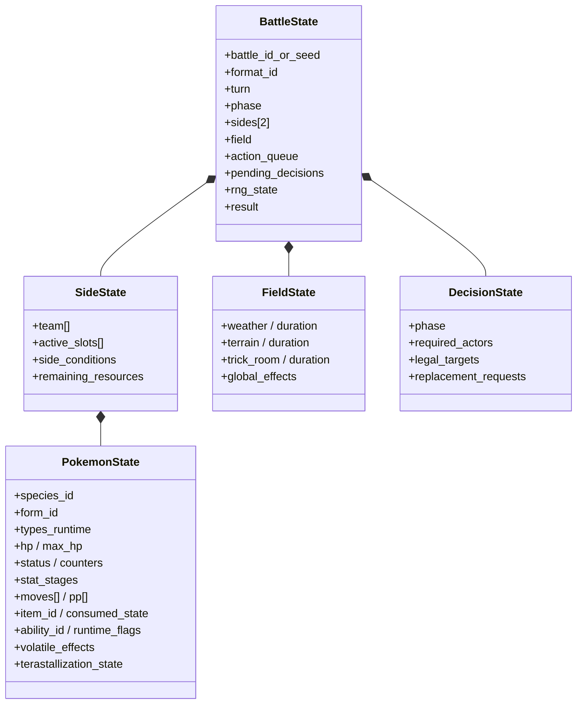

### Full state vs. policy observation

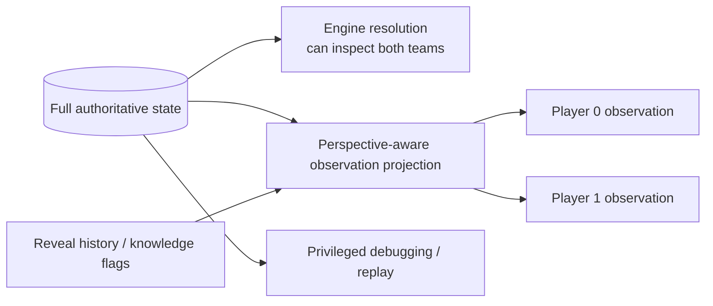

The simulator must retain the true hidden information, while the agent receives only legally observable information. Do not conflate the battle state with a flattened ML feature vector.

## 5. Kernel interface and mutation invariants

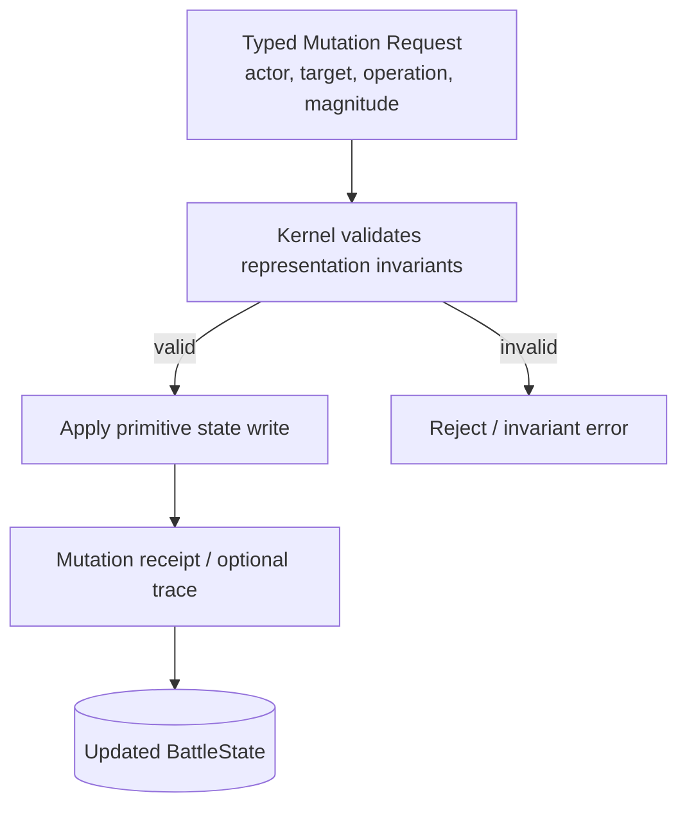

Suggested kernel surface (names illustrative):

```rust
pub trait BattleKernel {
    fn damage_hp(&mut self, target: PokemonRef, amount: u32) -> HpDelta;
    fn heal_hp(&mut self, target: PokemonRef, amount: u32) -> HpDelta;
    fn change_stage(&mut self, target: PokemonRef, stat: BoostStat, delta: i8) -> StageDelta;
    fn set_status(&mut self, target: PokemonRef, status: StatusId) -> StatusChange;
    fn consume_item(&mut self, target: PokemonRef) -> ItemChange;
    fn switch_active(&mut self, side: SideId, slot: ActiveSlot, incoming: TeamSlot) -> SwitchChange;
    // Plus bounded field, side, volatile, PP, counter and phase operations.
}
```

**Boundary:** mechanics decides whether a burn, stat change, switch, or item activation is allowed; the kernel enforces that the resulting representation remains coherent. For example, the kernel clamps stage changes within the supported range but does not decide whether Clear Body blocks them.

**Atomicity:** compound mechanics should emit a known series of primitive mutations, or use an explicit transaction/checkpoint protocol if all-or-nothing semantics are required. Do not silently roll back Pokémon rules effects because of generic exceptions.

## 6. Unified move definition model

Use *typed, data-driven move definitions* as the primary authoring representation, not opaque raw byte streams.

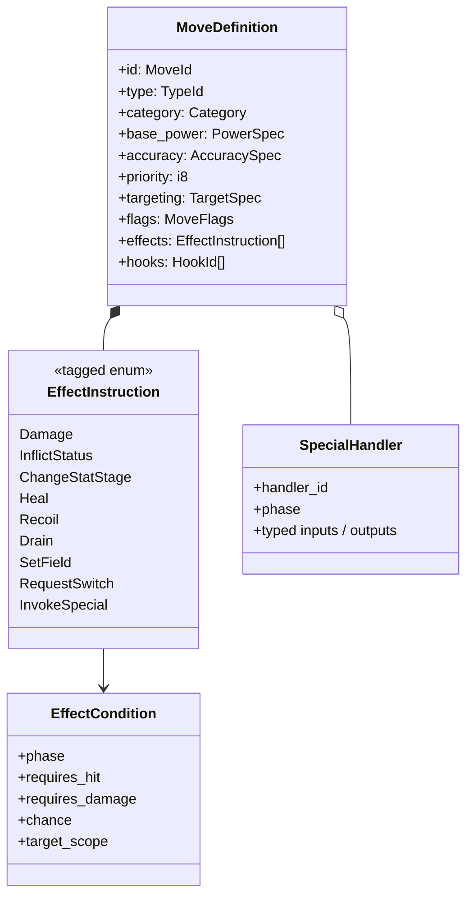

Illustrative Rust-like representation:

```rust
struct MoveDefinition {
    id: MoveId,
    move_type: TypeId,
    category: Category,
    power: PowerSpec,
    accuracy: AccuracySpec,
    priority: i8,
    target: TargetSpec,
    flags: MoveFlags,
    effects: &'static [EffectInstruction],
    hooks: &'static [HookBinding],
}

enum EffectInstruction {
    Damage,
    TryStatus { status: StatusId, chance: Percent, when: EffectTiming },
    ChangeStage { target: EffectTarget, stat: BoostStat, delta: i8, when: EffectTiming },
    Drain { fraction: Ratio, when: EffectTiming },
    Recoil { fraction: Ratio, when: EffectTiming },
    Invoke { handler: SpecialHandlerId, when: EffectTiming },
}
```

A move's **behavior is not determined solely by the sequence of instruction bytes**. Execution timing, target iteration, prerequisites, success/failure conditions, and event windows are part of its semantic contract.

### Complexity tiers

| Tier | Definition approach | Representative examples |
|---|---|---|
| Standard | Data + ordinary effect instructions | Flamethrower, Thunderbolt |
| Composed | Multiple timed/conditional effects | Close Combat, Drain Punch |
| Specialized | Data + bounded phase-specific handler(s) | Protect, U-turn, Population Bomb, Trick Room |

**No duplicate execution engines:** specialized moves plug into the common executor rather than implementing private versions of accuracy, damage, and action resolution.

## 7. Unified move execution pipeline

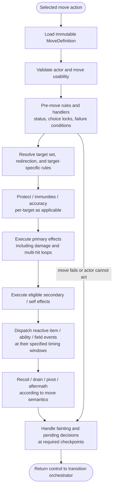

> **Ordering warning:** this is a conceptual map, **not** a literal universal Pokémon order. Accuracy, protection, immunity, individual multi-hit strikes, recoil, triggered abilities, fainting, and switching can interleave. The executor must use an explicit ordered phase/event model rather than dispatching every reaction only at the end.

## 8. Event system and synchronous reactions

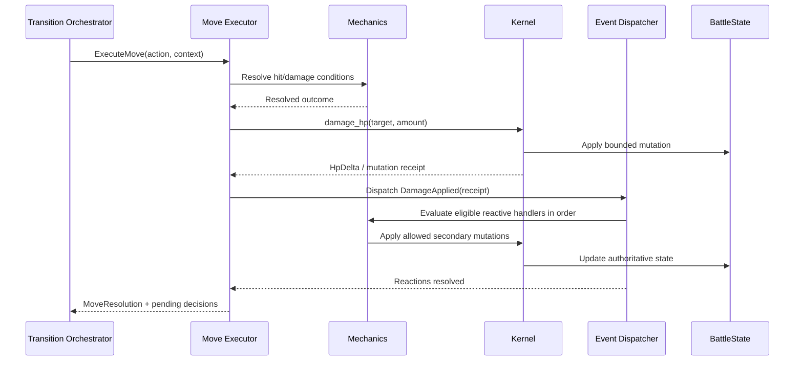

Define each event with a typed payload, originating action, source/target identity, timing window, and ordering key. Examples include `TerrainChanged`, `ItemConsumed`, `StatStageChanged`, `DamageApplied`, `StatusApplied`, `PokemonEntered`, `PokemonFainted`, and `MoveCompleted`.

**Dispatcher rules:** handlers only request mutations through mechanics/kernel; handler iteration is deterministic; recursive/cascading effects have explicit ordering and loop limits; diagnostic events do not themselves drive battle semantics.

## 9. Example: Grassy Seed + Unburden

```mermaid
sequenceDiagram
    participant T as Terrain mechanics
    participant E as Event Dispatcher
    participant I as Grassy Seed handler
    participant K as Mutation Kernel
    participant A as Unburden handler
    participant S as BattleState
    T->>K: set_terrain(Grassy)
    K->>S: Update field
    T->>E: TerrainChanged(Grassy)
    E->>I: Evaluate held-item trigger
    I->>I: Holder affected? Grounded? Item present?\nApplicable activation timing?
    alt Seed activation allowed
        I->>K: change_stage(holder, Defense, +1)
        K->>S: Apply stage delta
        I->>K: consume_item(holder)
        K->>S: Remove item / update consumed state
        I->>E: ItemConsumed(holder, GrassySeed)
        E->>A: Check Unburden ability conditions
        A->>K: mark_unburden_active(holder)
        K->>S: Update runtime ability flag
    end
    Note over A,S: Effective Speed mechanics applies ×2 while\nUnburden conditions hold; switching resets the flag.
```

This example illustrates why an item/ability cannot simply be a passive numerical multiplier. Correct behavior requires **event timing, stateful activation, and cross-system effects**. Verify exact battle ordering and edge cases against an authoritative reference and fixtures.

## 10. Turn transition, action queue, and replacement phases

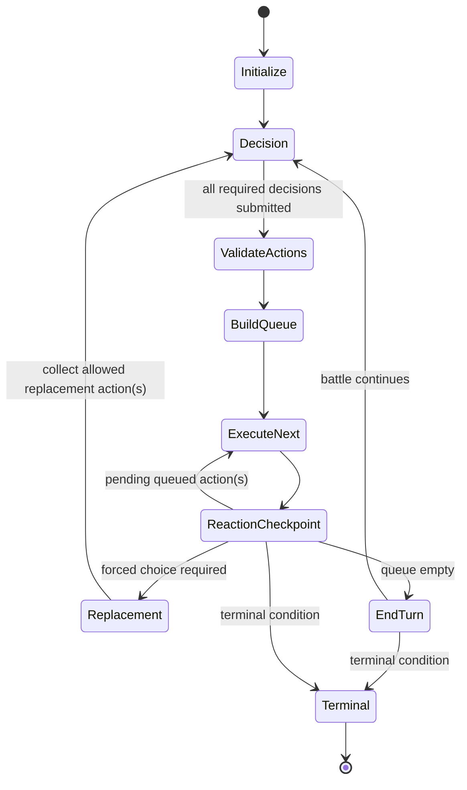

Key requirements:

- Simultaneous decisions are gathered for the current decision phase, then ordered by priority/speed/tie-breaking and applicable Pokémon rules.
- The queue must retain action identity and targets, and support invalidation (for example, fainting before an action resolves).
- Switching, replacement, redirection, field effects, ability triggers, and item triggers use deterministic ordering.
- Doubles needs two active slots per side, target sets, spread-move behavior, ally interactions, and more than two action choices per turn.
- Fainting/forced replacements and mid-turn decisions must be explicitly represented; do not assume every full turn is exactly one call to `step`.

## 11. RNG and deterministic replay

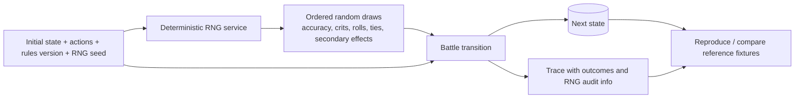

Choose and document whether RNG state is embedded in `BattleState` or supplied as an explicit input that returns a successor RNG state. Never hide nondeterminism behind global random calls. Avoid consuming RNG from inactive branches if that breaks reproducibility expectations. Include rules/content version identifiers in replay fixtures.

## 12. Static content, compilation, and performance

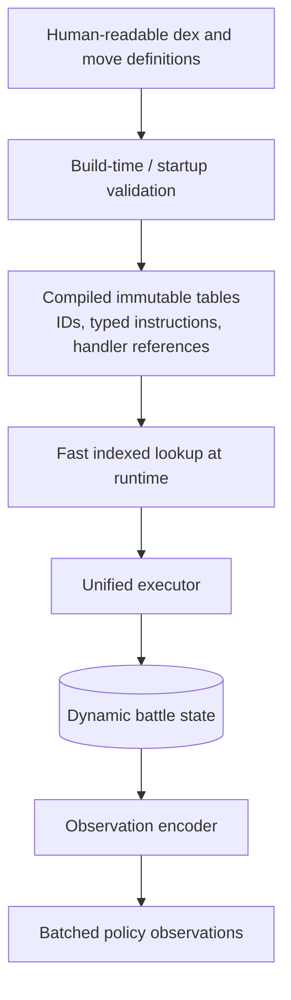

Begin with readable typed definitions. Only consider packed bytecode or a custom instruction stream **after profiling** demonstrates a material benefit. Opaque bytes would otherwise make mechanics inspection, event ordering, and tests harder. Optimize storage and dispatch separately from the **semantic architecture**.

## 13. Batch simulation boundary (Rotom Brawl)

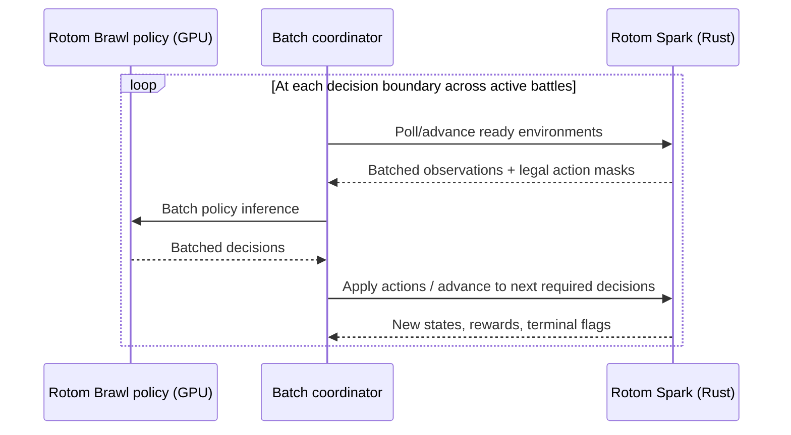

A batch interface should amortize Python/Rust crossing costs. Individual environments may reach decision boundaries asynchronously; the coordinator should manage ready subsets rather than forcing every battle to advance identically. Keep policy inference separate from authoritative battle resolution.

## 14. Testing strategy

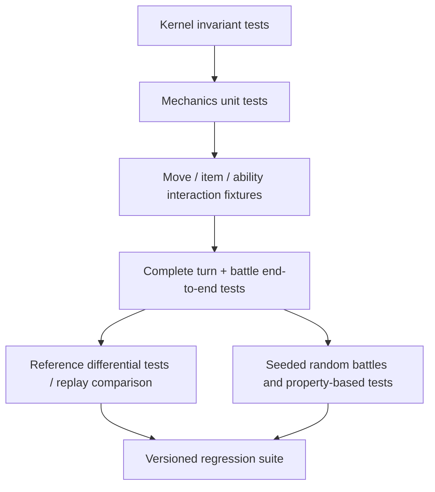

Recommended invariants and assertions:

- HP, PP, stat stages, IDs, team slots, and field durations stay within valid representational bounds.
- A given state/action/RNG combination produces byte-for-byte-equivalent next-state serialization (or a documented canonical equivalence).
- Ability/item/event handler dispatch order is deterministic; event cascades terminate.
- Move effects execute at the correct timing and target scope; a failed effect does not leak unrelated state mutations.
- Hidden information never leaks into policy observations.
- Singles-like test scenarios are not used as a substitute for doubles targeting and multi-action fixtures.
- Reproduce complex fixtures: terrain seed + Unburden, Protect interactions, multi-hit effects, switching after damage, weather/terrain expiration, and simultaneous faints.

## 15. Suggested Rust module boundaries

```text
rotom-spark/
  state/          # BattleState, SideState, PokemonState, FieldState, IDs
  kernel/         # invariant-safe mutation API and receipts
  mechanics/      # calculations, eligibility, ordering and rules
  events/         # typed semantic events, trigger registry, dispatcher
  moves/          # move definitions, typed effects, unified executor, special hooks
  abilities/      # ability handler definitions and registration
  items/          # item handler definitions and registration
  dex/            # static content loader/compiler and IDs
  transition/     # decisions, action queue, phases, fainting, turn lifecycle
  rng/            # deterministic random stream
  observation/    # perspective-aware features and legal masks
  diagnostics/    # optional traces, rendering and replay
  batch/          # vectorized/parallel environment API for Brawl
  tests/          # fixtures, invariants, reference and differential tests
```

This is a conceptual module map; align names with the current repository rather than reorganizing solely for aesthetics.

## 16. Architecture decisions and anti-patterns

| Decision | Preferred rule | Avoid |
|---|---|---|
| Authority | One authoritative `BattleState` | Duplicate mutable truth in callbacks, observations, or logs |
| Mutation | Typed kernel operations | Raw unrestricted mutable state access |
| Responsibility | Mechanics evaluates rules, kernel enforces representation | Kernel embedding every Pokémon-specific exception |
| Moves | Unified pipeline + typed effects + bounded hooks | A unique independent executor per move |
| Serialization | Readable source definitions and optional compiled encoding | Opaque byte stream as the only editable source |
| Events | Deterministic typed synchronous dispatch | Unordered listeners / arbitrary callback recursion |
| RNG | Explicit deterministic source and auditability | Global randomness or nondeterministic handler order |
| Performance | Benchmark batch throughput and profile bottlenecks | Premature bytecode/packing that obscures correctness |
| Observations | Per-player redacted projection | Giving policies the full privileged state |

## 17. Implementation roadmap

```mermaid
flowchart LR
    A[1. Stabilize state model + invariants] --> B[2. Kernel operations + receipts]
    B --> C[3. Mechanics contracts]
    C --> D[4. Typed events + ordered dispatcher]
    D --> E[5. Declarative move definitions + executor]
    E --> F[6. Specialized hooks + item/ability integration]
    F --> G[7. Doubles fidelity + differential fixtures]
    G --> H[8. Batch API + profiling]
```

**Vertical slices are preferable to big-bang rewrites.** First prove an ordinary attack end-to-end. Then cover conditional effects, item/ability interactions, interrupts, multiple targets, and switching. At each stage retain deterministic replay fixtures and invariant tests.

## 18. The architectural contract in one sentence

> **BattleState is the source of truth; the kernel is the only writer; mechanics decides what is allowed and what it means; moves are declarative programs executed through one pipeline; typed deterministic events connect reactive systems; the transition orchestrator advances the battle from one decision state to the next.**
